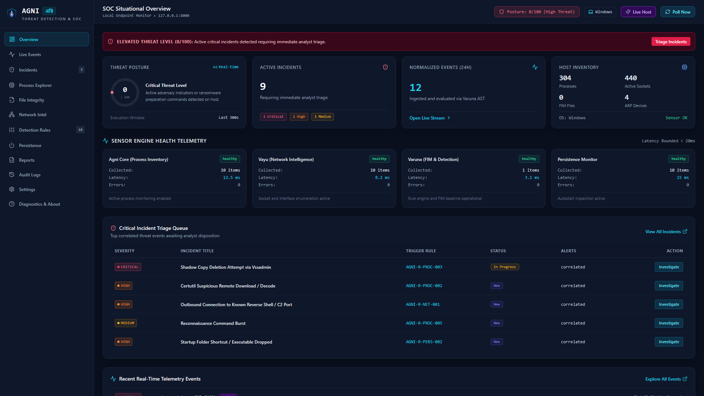
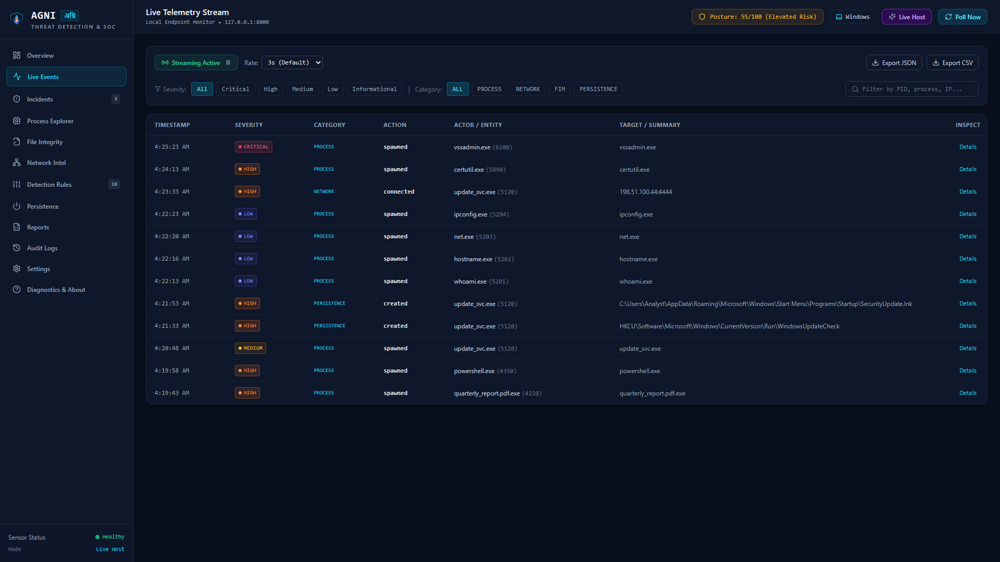
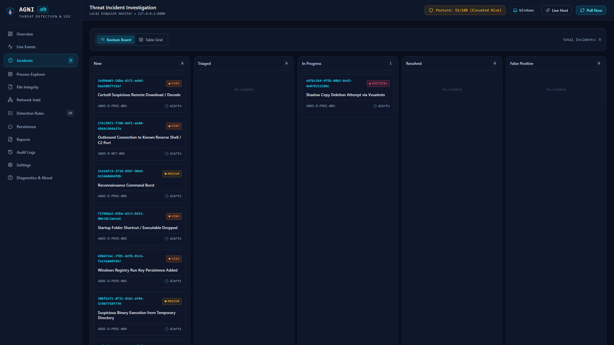
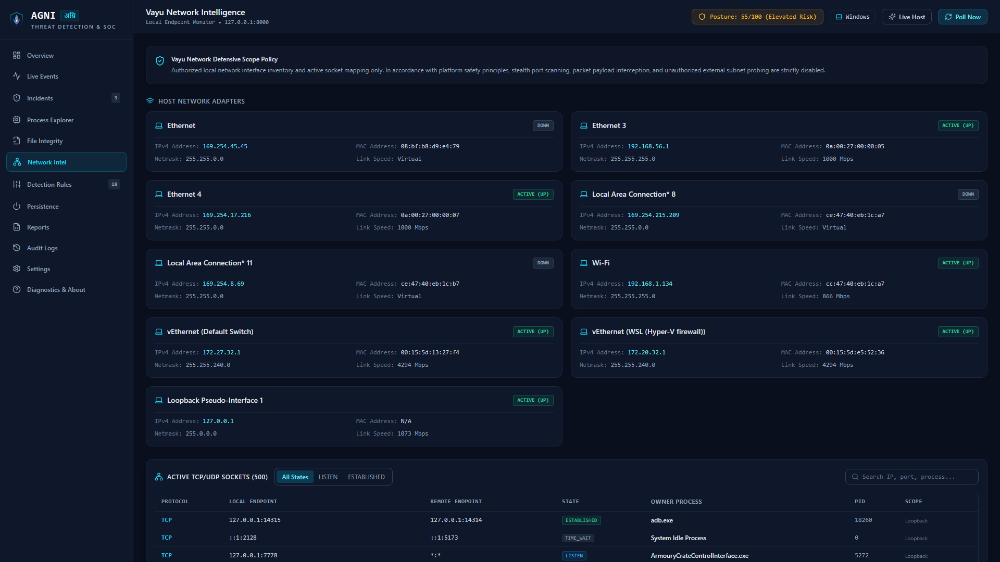
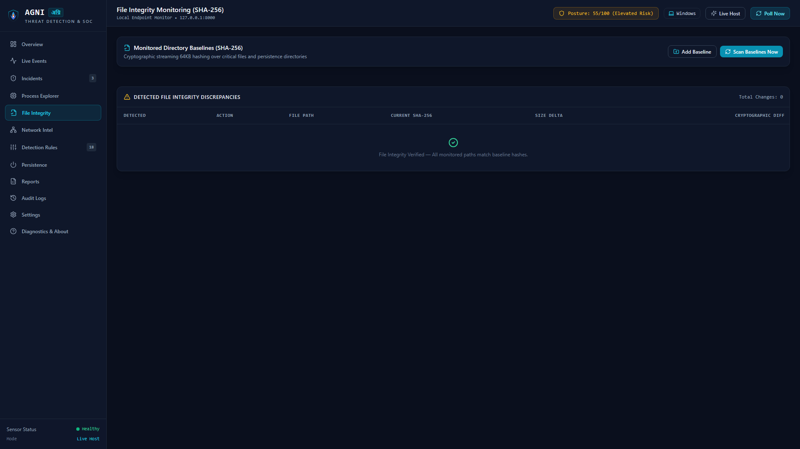
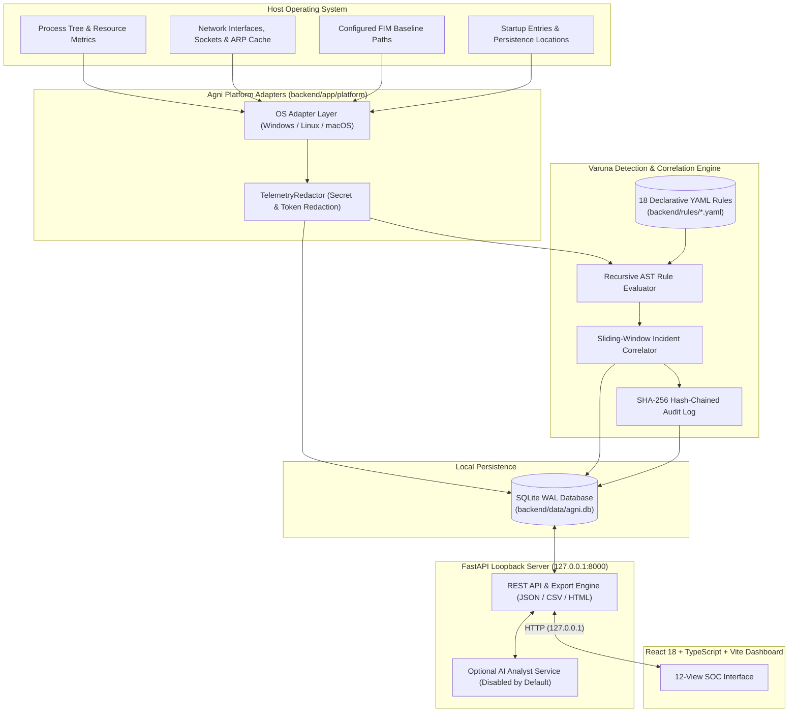

<div align="center">


### Cross-Platform, Local-First Threat Detection & Endpoint Security Operations

[](https://github.com/adiz777/Agni/actions/workflows/ci.yml)
[](LICENSE)
[](docs/platform-support.md)
[](backend/)
[](frontend/)
[](frontend/)
[](SECURITY.md)

[Overview](#-overview) • [Features](#-feature-highlights) • [Screenshots](#-screenshots--demonstrations) • [Architecture](#-architecture) • [Platform Matrix](#-platform-compatibility-matrix) • [Quick Start](#-quick-start) • [Configuration](#-configuration) • [Detection Engine](#-detection-engine) • [Security & Privacy](#-security--privacy) • [Testing](#-testing--quality) • [Structure](#-project-structure) • [Roadmap](#-roadmap) • [Contributing](#-contributing) • [License](#-license--attribution)

</div>

---

## 🛡️ Overview

**Agni (अग्नि)** is a local-first, cross-platform endpoint monitoring and threat detection platform with real-time event correlation and an interactive Security Operations Center (SOC) dashboard. Named after the Sanskrit word for the vigilant flame, Agni transforms host process, file integrity, persistence, and network telemetry into explainable security findings without shipping host telemetry to external cloud infrastructure.

### Why Agni?
Basic system-monitoring scripts list processes or sockets without security context, while commercial EDR agents require kernel drivers, cloud accounts, and opaque black-box scoring. Agni bridges that gap for blue-team engineers, security researchers, students, and privacy-conscious operators by providing:
- **Local-First Sovereignty**: All collection, normalization, rule evaluation, and SQLite (WAL) persistence run strictly on `127.0.0.1` by default.
- **Observed Facts vs. Interpretations**: Every alert separates raw OS observations (PID, SHA-256 hash, socket tuple, command line) from the rule's analytical interpretation and recommended investigation steps.
- **Honest Scope**: Agni is a user-space defensive monitoring and correlation platform—not a kernel-mode EDR, antivirus replacement, or automated remediation engine. It never silently kills processes, deletes files, or alters firewall rules.

---

## ✨ Feature Highlights

### Module A — Agni Core: Endpoint & File Integrity Monitoring
- **Process Inventory & Inspection**: Enumerates active processes with PID, PPID, parent-child lineage, executable path, SHA-256 binary hash (where readable), start time, username, and CPU/memory usage.
- **File Integrity Monitoring (FIM)**: User-configured directory baselines using chunked SHA-256 hashing (`64 KB` blocks, `100 MB` per-file safety ceiling) to detect file creation, modification, and deletion.
- **Read-Only Startup & Persistence Visibility**: Inspects OS-specific autostart locations (Windows Run/RunOnce Registry keys, Startup folders, and scheduled tasks; Linux `systemd` units, cron, and shell profiles; macOS `LaunchAgents` and `LaunchDaemons`).
- **Sensor Health Telemetry**: Tracks collector status, latency, and permission degradation across subsystems.

### Module B — Vayu: Network Intelligence
- **Interface & Socket Inventory**: Lists local network adapters (IPv4/IPv6/MAC, link speed, UP/DOWN status) and active TCP/UDP connections mapped to owning PIDs.
- **Authorized Scope & Passive Device Discovery**: Validates private RFC 1918 CIDR scopes and reads the local OS ARP cache (`arp -a` / `arp -an` with `shell=False`) to track known LAN neighbors with first-seen and last-seen timestamps.
- **Connection Anomaly Detection**: Flags suspicious outbound ports, non-standard C2 channels, and unusual per-process socket volume.

### Module C — Varuna: Event Intelligence & Correlation
- **Normalized Event Pipeline**: Converts heterogeneous OS telemetry into a versioned common event schema (`PROCESS`, `FILE`, `NETWORK`, `PERSISTENCE`, `AUTH`, `SYSTEM`) with five severity tiers (`INFO`, `LOW`, `MEDIUM`, `HIGH`, `CRITICAL`).
- **Declarative AST Rule Engine**: Evaluates YAML/JSON rules (`all`, `any`, `not`, `equals`, `contains`, `startswith`, `endswith`, `regex`, `in`) against live or sample telemetry.
- **Sliding-Window Correlation & Deduplication**: Correlates related detections within configurable time windows (default `300s`) into structured Incidents with Kanban status (`NEW`, `TRIAGED`, `IN_PROGRESS`, `RESOLVED`, `FALSE_POSITIVE`), analyst notes, and JSON/CSV/HTML export.
- **Sample / Demo Telemetry Mode (Explicitly Labeled)**: Generates isolated multi-stage intrusion scenarios (`apt_intrusion`, `ransomware_prep`, `lateral_movement`) clearly tagged as sample data (`source="sample_generator"`) and purgeable in one click.

### SOC Dashboard & Optional AI Analyst
- **12 Integrated SOC Views**: Overview, Live Events, Incidents, Process Explorer, File Integrity, Network Intelligence, Detection Rules, Startup & Persistence, Reports, Audit Logs, Settings, and Diagnostics & About.
- **Optional AI Investigation Assistant (Disabled by Default)**: Supports local Ollama endpoints (`http://127.0.0.1:11434`) or user-configured hosted endpoints with explicit consent prompts, automatic PII/secret redaction (`TelemetryRedactor`), and deterministic offline fallback.

---

## 📸 Screenshots & Demonstrations

> **Note on Demonstration Data:** The screenshots below were captured from the live FastAPI + React application running on Windows with the explicitly labeled **Sample APT Intrusion Scenario** seeded alongside read-only local host adapter/process views. No private credentials or sensitive personal files are shown.

<div align="center">

### 1. Situational Overview & Real-Time Threat Posture
*Displays endpoint threat posture score, sensor health status, severity breakdown, and active incident triage queue.*


<br/><br/>

### 2. Live Events Stream & Evidence Inspector
*Filterable event stream with severity/category filters, search, and observed telemetry details.*


<br/><br/>

### 3. Incidents & Kanban Investigation Workflow
*Correlated multi-stage security incidents grouped by rule and entity across workflow columns.*


<br/><br/>

### 4. Vayu Network Intelligence & Socket Ownership
*Local network interfaces, active socket-to-PID mappings, and passive ARP neighbor inventory.*


<br/><br/>

### 5. File Integrity Monitoring (SHA-256 Baselines)
*Configured directory baselines, verification timestamps, and cryptographic hash drift records.*


</div>

---

## 🏛 Architecture

Agni separates OS-specific telemetry collection (`backend/app/platform/`) from normalization, AST rule evaluation (`backend/app/engine/`), SQLite WAL persistence, and the React 18 frontend:



See [`docs/architecture.md`](docs/architecture.md) for detailed component contracts and data flow.

---

## 💻 Platform Compatibility Matrix

Agni uses `psutil` and OS-specific adapters (`WindowsPlatformAdapter`, `LinuxPlatformAdapter`, `DarwinPlatformAdapter`). When running as a standard non-administrative user, inaccessible system processes or protected files are gracefully skipped and reported in sensor diagnostics rather than crashing the engine.

| Platform | Verification Status | Supported Capabilities | Known Restrictions & Permissions |
| :--- | :---: | :--- | :--- |
| **Windows 10 / 11** | **Tested** (Live host + CI) | Process tree, SHA-256 FIM, Registry Run/RunOnce & Startup folder persistence, socket-to-PID mapping, passive `arp -a` discovery, Task Scheduler helper script. | Protected `SYSTEM` processes require elevation for full executable path/hash inspection; works safely as standard user with partial visibility notice. |
| **Ubuntu / Debian / Kali Linux** | **Tested in CI** (Ubuntu GitHub Actions + unit-tested adapter) | `/proc` process inspection, SHA-256 FIM, `systemd` / `cron` / `rc.local` persistence visibility, socket table, `arp -an` / `/proc/net/arp` discovery, `systemd --user` service helper. | Reading other users' `/proc/<pid>/fd` sockets requires `CAP_NET_ADMIN` or root; standard user sees user-owned sockets and global interface stats. |
| **macOS (Apple Silicon & Intel)** | **Implemented (Unit-tested via mock)** | `psutil` process & resource inventory, SHA-256 FIM, `~/Library/LaunchAgents` & `/Library/LaunchDaemons` plist inspection, `arp -an` cache parsing, `launchctl` user agent helper. | `psutil.net_connections()` on macOS restricts non-root users from enumerating sockets owned by other UIDs; adapter degrades gracefully and flags permission state. |

See [`docs/platform-support.md`](docs/platform-support.md) for the full feature-by-feature breakdown.

---

## ⚡ Quick Start

### Prerequisites
- **Python 3.11+** (`python --version`)
- **Node.js 18+** and **npm** (`node --version`)
- **Git** (`git --version`)
- *No administrator/root privileges are required for standard operation.*

### 1. Clone the Repository
```bash
git clone https://github.com/adiz777/Agni.git
cd Agni
```

### 2. Backend Setup & Launch

#### Windows (PowerShell)
```powershell
python -m venv .venv
.\.venv\Scripts\Activate.ps1
pip install -r backend\requirements.txt
Copy-Item .env.example .env

# Option A: Use the launcher script (validates prerequisites & writes agni.pid)
.\scripts\windows\start-agni.ps1 -NoBrowser

# Option B: Direct uvicorn command
python -m uvicorn app.main:app --host 127.0.0.1 --port 8000 --app-dir backend --reload
```

#### Linux / macOS (Bash / Zsh)
```bash
python3 -m venv .venv
source .venv/bin/activate
pip install -r backend/requirements.txt
cp .env.example .env

# Option A: Use the launcher script
chmod +x scripts/unix/*.sh
./scripts/unix/start-agni.sh --no-browser

# Option B: Direct uvicorn command
python3 -m uvicorn app.main:app --host 127.0.0.1 --port 8000 --app-dir backend --reload
```

### 3. Frontend Setup & Launch
Open a second terminal in the repository root:
```bash
cd frontend
npm install
npm run dev -- --host 127.0.0.1 --port 5173
```

### 4. Access & Stop the Application
- **SOC Dashboard**: `http://127.0.0.1:5173`
- **OpenAPI / Swagger UI**: `http://127.0.0.1:8000/docs`
- **Diagnostics Check**: Run `.\scripts\windows\diagnose-agni.ps1` (Windows) or `./scripts/unix/diagnose-agni.sh` (Unix).
- **Stop Application**: Press `Ctrl+C` in the terminal or run `.\scripts\windows\stop-agni.ps1` / `./scripts/unix/stop-agni.sh`.

---

## ⚙️ Configuration

Agni reads settings from environment variables or a local `.env` file (see [`.env.example`](.env.example)).

| Variable | Purpose | Default | Sensitive? |
| :--- | :--- | :--- | :---: |
| `AGNI_HOST` | Local bind address for the FastAPI backend | `127.0.0.1` | No |
| `AGNI_PORT` | Local TCP port for the FastAPI backend | `8000` | No |
| `AGNI_ALLOW_EXTERNAL_BIND` | Permits binding to non-loopback addresses when explicitly set to `true` | `false` | No |
| `AGNI_DATABASE_URL` | SQLAlchemy SQLite database connection URI | `sqlite:///./data/agni.db` | No |
| `AGNI_TELEMETRY_INTERVAL_SECONDS` | Polling interval for endpoint process/sensor snapshots | `5` | No |
| `AGNI_FIM_POLL_INTERVAL_SECONDS` | Verification interval for File Integrity Monitoring baselines | `60` | No |
| `AGNI_NETWORK_POLL_INTERVAL_SECONDS` | Polling interval for sockets and passive ARP cache | `15` | No |
| `AGNI_CORRELATION_WINDOW_SECONDS` | Sliding time window used by Varuna to group related detections | `300` | No |
| `AGNI_EVENT_RETENTION_DAYS` | Days to retain historical events before pruning | `30` | No |
| `AGNI_MAX_REQUEST_SIZE_BYTES` | Maximum accepted HTTP request body size (`10 MB`) | `10485760` | No |
| `AGNI_MAX_FIM_FILE_SIZE_BYTES` | Maximum file size hashed during FIM scans (`100 MB`) | `104857600` | No |
| `AGNI_MAX_SOCKETS_PER_CYCLE` | Upper bound on active sockets processed per poll cycle | `2000` | No |
| `AGNI_DEMO_MODE_DEFAULT` | Starts the platform with synthetic sample mode enabled if `true` | `false` | No |
| `AGNI_AI_PROVIDER` | Optional AI analyst provider (`none`, `ollama`, `hosted`) | `none` | No |
| `AGNI_AI_OLLAMA_URL` | Local Ollama base URL when `AGNI_AI_PROVIDER=ollama` | `http://127.0.0.1:11434` | No |
| `GEMINI_API_KEY` | Optional API key for hosted AI provider (never stored in Git) | *(unset)* | **Yes** |

---

## 🧠 Detection Engine

The **Varuna** engine (`backend/app/engine/`) processes normalized events through three stages:
1. **Normalization**: Maps OS telemetry into `NormalizedEvent` records with observed attributes (`actor_name`, `actor_cmdline`, `target_path`, `remote_ip`, `remote_port`, `metadata`).
2. **AST Rule Matching**: Evaluates enabled YAML rules from `backend/rules/` against each event. Every rule includes an ID, MITRE ATT&CK mapping, severity, recursive condition tree (`all` / `any` / `not`), explanation, false-positive notes, and recommended investigation steps.
3. **Sliding-Window Incident Correlation**: Groups matching detections sharing an entity (process, file path, or remote endpoint) within `correlation_window_seconds` into an `Incident`, preventing duplicate alert floods.

### Example Detection Rule (`backend/rules/proc_shadow_copy_delete.yaml`)
```yaml
id: AGNI-R-PROC-003
name: Shadow Copy Deletion Attempt via Vssadmin
description: Detects execution of vssadmin.exe to delete Volume Shadow Copies, a common pre-ransomware inhibit-system-recovery technique.
severity: CRITICAL
category: PROCESS
mitre_tactic: Impact
mitre_technique: T1490
version: "1.0.0"
enabled: true
correlation_window_seconds: 300
condition:
  all:
    - field: category
      op: equals
      value: PROCESS
    - field: action
      op: equals
      value: spawned
    - any:
        - field: actor_name
          op: equals
          value: vssadmin.exe
        - field: actor_cmdline
          op: regex
          value: "(?i)vssadmin(\\.exe)?\\s+delete\\s+shadows"
explanation: >
  Observed fact: A process matching vssadmin shadow deletion syntax was spawned.
  Interpretation: Adversaries frequently delete Volume Shadow Copies before deploying ransomware,
  though backup software or administrators performing disk maintenance can also trigger this command.
recommended_steps:
  - Inspect the parent process (PPID) and user account that invoked vssadmin.exe.
  - Check whether scheduled backup maintenance was active at the timestamp.
  - Review recent File Integrity Monitoring (FIM) alerts for mass file modifications.
```

---

## 🔒 Security & Privacy

- **What Agni Collects**: Process metadata, SHA-256 hashes of user-configured FIM directories, local network interface/socket metadata, passive ARP cache entries, and read-only startup entries.
- **Where Data Is Stored**: Exclusively in a local SQLite database (`backend/data/agni.db`, excluded from Git) on your machine.
- **Zero Automatic Cloud Transmission**: No telemetry leaves your machine unless you explicitly enable a hosted AI provider in Settings and confirm consent for an individual analysis request.
- **Automatic Redaction**: Command lines and payloads pass through `TelemetryRedactor` to strip bearer tokens, API keys, passwords, and private credentials before storage or AI summarization.
- **No Destructive Actions**: Agni never kills processes, deletes or quarantines files, modifies firewall rules, or installs kernel drivers.
- **Tamper-Evident Audit Log**: Configuration changes, rule toggles, baseline updates, and report exports are recorded in a SHA-256 hash-chained audit table (`AuditLog`) verifiable via `/api/v1/audit/verify`.

See [`docs/threat-model.md`](docs/threat-model.md) for the complete STRIDE threat model and trust boundaries.

---

## 🧪 Testing & Quality

Run the automated verification suites from the repository root:

```bash
# 1. Backend unit, integration, security & detection rule tests (101 passed)
python -m pytest tests/backend/ -v

# 2. 4-Tier End-to-End opaque-box verification runner (25 passed across 4 tiers)
python tests/e2e/runner.py

# 3. Backend Ruff linting & formatting check
python -m ruff check backend/ tests/ --config backend/pyproject.toml

# 4. Frontend Vitest component & navigation suite (20 passed)
cd frontend && npm run test -- --run

# 5. Frontend TypeScript typecheck & production build
cd frontend && npx tsc --noEmit && npm run build
```

GitHub Actions ([`.github/workflows/ci.yml`](.github/workflows/ci.yml)) automatically runs backend (`pytest`, E2E runner, `ruff`) and frontend (`vitest`, `tsc`, `vite build`) checks on every push and pull request.

---

## 📁 Project Structure

```text
Agni/
├── .github/
│   ├── ISSUE_TEMPLATE/          # Bug report and feature request templates
│   ├── workflows/ci.yml         # Automated GitHub Actions CI pipeline
│   └── PULL_REQUEST_TEMPLATE.md # Pull request verification checklist
├── backend/
│   ├── app/
│   │   ├── api/                 # FastAPI route handlers (health, events, incidents, fim, network, rules, ai, etc.)
│   │   ├── core/                # Config, loopback validation, CORS, path-traversal guards, logging
│   │   ├── engine/              # Varuna AST rule evaluator, sliding-window correlator, normalizer
│   │   ├── models/              # SQLAlchemy ORM models (Event, Incident, FIMBaseline, AuditLog, etc.)
│   │   ├── platform/            # OS-specific adapters (Windows, Linux, macOS)
│   │   ├── schemas/             # Pydantic v2 request/response schemas
│   │   ├── services/            # FIM scanner, AI analyst, audit chain, sample scenario generator
│   │   └── main.py              # FastAPI application entrypoint and lifespan manager
│   ├── rules/                   # 18 declarative YAML detection rules mapped to MITRE ATT&CK
│   ├── pyproject.toml           # Python project & Ruff configuration
│   └── requirements.txt         # Pinned backend Python dependencies
├── docs/
│   ├── assets/                  # Original SVG branding and 1080p application screenshots
│   ├── architecture.md          # Detailed system architecture and pipeline documentation
│   ├── development.md           # Developer setup, testing, and troubleshooting guide
│   ├── platform-support.md      # Cross-platform capability and permission matrix
│   └── threat-model.md          # STRIDE threat model, trust boundaries, and limitations
├── frontend/
│   ├── public/                  # Favicon and static assets
│   ├── src/
│   │   ├── api/                 # Typed REST client for backend communication
│   │   ├── assets/              # Agni SVG components and branding marks
│   │   ├── components/          # Sidebar, Header, Modals, and shared UI primitives
│   │   ├── context/             # Global application state, polling, and view routing
│   │   └── views/               # All 12 SOC dashboard views
│   ├── package.json             # Frontend dependencies and scripts
│   └── vite.config.ts           # Vite bundler and local API proxy configuration
├── scripts/
│   ├── unix/                    # Bash start, stop, diagnostics, and optional service installer
│   ├── windows/                 # PowerShell start, stop, diagnostics, and optional task installer
│   └── capture_screenshots.py   # Reproducible headless Chrome screenshot generator
├── tests/
│   ├── backend/                 # Pytest unit, API, security, and rule engine test suite
│   └── e2e/                     # 4-tier end-to-end verification harness and scenarios
├── .env.example                 # Safe environment variable template (placeholders only)
├── .gitignore                   # Excludes secrets, databases, virtualenvs, node_modules, caches
├── CHANGELOG.md                 # Release notes for v1.0.0
├── CODE_OF_CONDUCT.md           # Contributor Covenant Code of Conduct
├── CONTRIBUTING.md              # Contribution guidelines and quality gates
├── LICENSE                      # MIT License
├── README.md                    # Project overview and documentation
└── SECURITY.md                  # Vulnerability reporting policy and security scope
```

---

## 🗺️ Roadmap

- **Implemented (`v1.0.0`)**
  - [x] Cross-platform adapter architecture (`Windows`, `Linux`, `macOS`) with graceful privilege degradation
  - [x] Agni Core process inventory, startup/persistence inspection, and chunked SHA-256 File Integrity Monitoring
  - [x] Vayu network interface, socket-to-PID mapping, and passive ARP device inventory
  - [x] Varuna recursive AST rule engine, 18 default YAML rules, and sliding-window incident correlation
  - [x] 12-view React + TypeScript SOC dashboard with JSON, CSV, and HTML report exports
  - [x] SHA-256 hash-chained tamper-evident audit logging and optional privacy-preserving AI analyst
- **Planned (Future Milestones)**
  - [ ] Native event-driven filesystem watchers (`ReadDirectoryChangesW` / `inotify` / `FSEvents`) alongside periodic SHA-256 baseline scans
  - [ ] Windows Event Log (ETW / Security Channel) and Linux `auditd` stream adapters
  - [ ] Out-of-order historical event replay watermarking
  - [ ] Sigma-to-Varuna YAML rule converter CLI

---

## 🤝 Contributing

Contributions—whether new detection rules, platform adapter enhancements, bug fixes, or documentation improvements—are welcome! Please review [`CONTRIBUTING.md`](CONTRIBUTING.md) for development setup, coding standards, and pull request requirements, and follow our [`CODE_OF_CONDUCT.md`](CODE_OF_CONDUCT.md).

---

## 🚨 Security Reporting

Please **do not** report security vulnerabilities through public GitHub issues. Refer to [`SECURITY.md`](SECURITY.md) for responsible disclosure instructions and supported versions.

---

## 📄 License & Attribution

Distributed under the **MIT License**. See [`LICENSE`](LICENSE) for full license text. All third-party libraries (`FastAPI`, `Pydantic`, `SQLAlchemy`, `psutil`, `React`, `Lucide`, `Tailwind CSS`, `Vite`) are used in accordance with their respective open-source licenses.

---

## 👨‍💻 Author & Project Links

Built and maintained by **Aditya Zala**:
- **Repository**: [https://github.com/adiz777/Agni](https://github.com/adiz777/Agni)
- **GitHub Profile**: [https://github.com/adiz777](https://github.com/adiz777)
- **Website / Portfolio**: [https://adizala.me](https://adizala.me)

---

<div align="center">
  <sub><b>Agni (अग्नि)</b> — Built for transparent, local-first defensive security engineering. Explore the source, test the rules, open an issue, or contribute a pull request.</sub>
</div>
