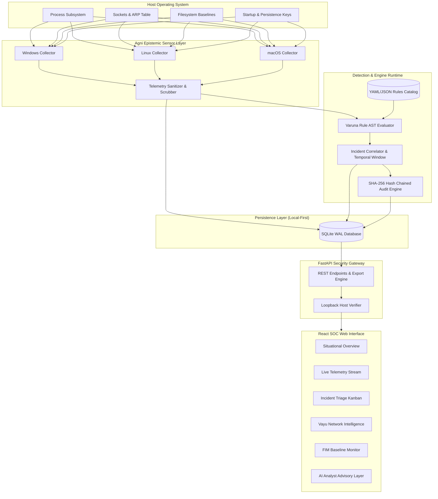

# Agni (अग्नि) Architectural Deep Dive

Agni is engineered as a **local-first, modular, non-destructive endpoint threat detection and security operations platform**. It bridges low-overhead OS-level telemetry collection with real-time rule evaluation, correlation, and SOC triage—running entirely on localhost without transmitting host telemetry to external infrastructure.



---

## 1. Epistemic Sensor & Telemetry Collection

The sensor layer gathers raw telemetry from host operating system APIs without deploying invasive kernel drivers or proprietary hooks.

### Architecture Principles:
- **Zero Kernel Panics / Non-Destructive**: Collects telemetry strictly using standard OS interfaces (`psutil`, `/proc`, Win32 API, `sysctl`, `netstat`/ARP caches).
- **Graceful Privilege Degradation**: If started as an unprivileged user, Agni continues monitoring all processes and sockets owned by that user. When access is denied on system-level processes, the sensor records `access_restricted=true` rather than failing.
- **Strict PII & Secret Scrubbing**: All command-line arguments, environment blocks, and file paths pass through the sanitization pipeline. Tokens, passwords (`password=***`, `api_key=***`, `-p ***`), and personal identifiers are redacted before telemetry records reach SQLite.

---

## 2. Varuna Detection & AST Rule Engine

The Varuna engine parses human-readable, declarative YAML detection rules into an Abstract Syntax Tree (AST) evaluated over incoming telemetry events.

### Rule Hierarchy & Operator Tree:
Rules are structured hierarchically:
- **Atomic Matchers**: String equals, substring `contains`, regex pattern, integer comparisons (`>`, `<`, `>=`).
- **Boolean Composition**: Logical `AND`, `OR`, `NOT`, and `ANY(n)` groupings.
- **MITRE ATT&CK Mapping**: Every rule links directly to Tactics (e.g., Execution, Defense Evasion, Persistence) and Techniques (e.g., T1059, T1490).

### Rule Syntax Specification:
```yaml
id: AGNI-R-PROC-003
title: Shadow Copy Deletion Attempt via Vssadmin
severity: CRITICAL
status: active
mitre_attack:
  tactic: Defense Evasion / Impact
  technique: T1490
conditions:
  and:
    - field: category
      operator: equals
      value: PROCESS
    - field: action
      operator: equals
      value: spawned
    - or:
        - field: actor_name
          operator: equals
          value: vssadmin.exe
        - field: actor_cmdline
          operator: regex
          value: (?i)vssadmin(\.exe)?\s+delete\s+shadows
remediation:
  summary: Potential ransomware activity attempting to prevent system restoration.
  recommended_actions:
    - Isolate host immediately from network.
    - Terminate offending process tree.
```

---

## 3. Sliding Window Incident Correlation

Individual alerts are synthesized into actionable **Incidents** using a temporal sliding correlation window (default: 300 seconds).

1. **Entity Linking**: Events sharing an `actor_pid`, `hostname`, related network endpoint, or execution chain are grouped together.
2. **Alert Severity Aggregation**: When multiple alerts trigger within the sliding window, the incident's severity is dynamically escalated (e.g., Medium reconnaissance + High C2 connection -> High/Critical Incident).
3. **Deduplication**: Duplicate alerts caused by repetitive loop commands are collapsed to prevent SOC alert fatigue.

---

## 4. Cryptographic Hash-Chained Audit Trail

Every state-modifying action (incident status change, rule disablement, demo data reset) generates an audit entry structured as an immutable cryptographic blockchain:

$$\text{Hash}_n = \text{SHA-256}\Big(\text{Index}_n \parallel \text{Timestamp}_n \parallel \text{Action}_n \parallel \text{Hash}_{n-1}\Big)$$

The dashboard provides a one-click verification function that recomputes the entire audit log chain. Any unauthorized manual SQLite edits or dropped records immediately invalidate the sequence.

---

## 5. React SOC Frontend & Situational Awareness

The frontend is constructed using React 18, TypeScript, Vite, and Tailwind CSS.

- **Reactive State Architecture**: View switching is hash- and pathname-synced (`#/overview`, `#/events`, `#/incidents`, `#/fim`, `#/network`).
- **Visual Kanban Board & Table Views**: Incidents can be triaged across status columns (`New`, `Triaged`, `In Progress`, `Resolved`, `False Positive`).
- **Real-Time Stream Simulation**: Live event polling dynamically populates UI tables with latency indicators and bounded memory consumption.
